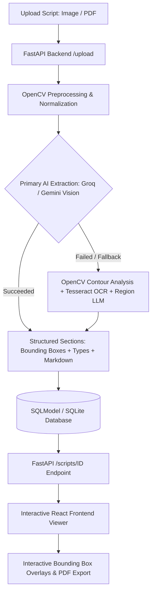

# HASA: Handwritten Answer Script Analyzer & Evaluator

<p align="center">
  <strong>An AI-powered document layout analysis and intelligent evaluation platform for handwritten academic answer sheets and exam scripts.</strong>
</p>

<p align="center">
  
  
  
  
  
  
  
</p>

---

## 📖 Overview

**HASA (Handwritten Answer Script Analyzer & Evaluator)** transforms unstructured, handwritten student exam papers and assignment sheets into structured, interactive digital records. 

By combining **Computer Vision (OpenCV)** and modern **Multimodal Large Language Models (Groq Vision / Google Gemini)** with fallback **Tesseract OCR**, HASA detects document structure, isolates questions from answers, transcribes handwriting into markdown with LaTeX math formatting, reconstructs tables, and explains drawn diagrams or schematics.

---

## ✨ Key Features

- **Multimodal AI Layout Analysis**:
  - **Single-Pass Full-Page Extraction**: Parses the whole script image in one go via Vision LLMs (e.g., Qwen 3.8 / Gemini Flash) to prevent rate-limit bottlenecks and eliminate fragmented lines.
  - **Fallback Computer Vision Engine**: Automatic fallback to adaptive thresholding, morphological contour dilation, and localized bounding box extraction if API limits are reached.
- **Semantic Classification**: Automatically categorizes detected areas into:
  - 🏷️ **Header & Metadata**: Document title, student roll number, module, and dates.
  - ❓ **Questions**: Question numbers and prompts.
  - ✍️ **Text / Answers**: Verbatim handwritten student solutions in clean Markdown.
  - 📊 **Tables**: Handwritten or printed grid data rendered into Markdown tables.
  - 🎨 **Diagrams & Schematics**: Visual explanations and structural breakdowns of diagrams.
- **Interactive Visual Inspector**:
  - **Side-by-Side Comparison**: View original uploaded image/PDF alongside the structured transcriptions.
  - **Bidirectional Highlighting**: Hover or click SVG bounding boxes on the document image to jump to and highlight corresponding transcription cards, and vice-versa.
  - **Filter by Type**: Instantly filter sections (Headers, Questions, Text, Tables, Diagrams).
  - **Export to PDF**: Generate clean, formatted PDF reports using built-in client-side rendering.
  - **Theme Toggle**: Polished Dark and Light themes with persistent state.

---

## 🏗️ Architecture & Pipeline



---

## 🛠️ Tech Stack

### Backend
- **Framework**: [FastAPI](https://fastapi.tiangolo.com/) with asynchronous non-blocking request handlers
- **ORM & Database**: [SQLModel](https://sqlmodel.tiangolo.com/) & SQLite
- **Computer Vision**: OpenCV (`opencv-python`), NumPy
- **OCR Engine**: [Tesseract OCR](https://github.com/tesseract-ocr/tesseract) via `pytesseract`
- **Multimodal AI**:
  - Groq Vision API (`qwen/qwen3.8-27b` via `httpx`)
  - Google GenAI SDK (`google-genai` for `gemini-2.5-flash` / `gemini-2.0-flash`)
- **PDF & Document Utilities**: `pymupdf` (FitZ)

### Frontend
- **Framework**: [React 18](https://react.dev/) + [Vite](https://vitejs.dev/)
- **Markdown & Math**: `react-markdown`, `remark-gfm`
- **PDF Generation**: `jspdf`, `html2canvas`

---

## 📁 Project Structure

```text
HASA/
├── app/                      # Backend FastAPI Application
│   ├── cv/                   # Computer Vision & Multimodal Modules
│   │   ├── gemini_helper.py  # Groq & Gemini Vision Prompts and API Clients
│   │   ├── layout.py         # OpenCV Contour Detection & Table Heuristics
│   │   ├── ocr.py            # Tesseract OCR Integration
│   │   └── preprocess.py     # Image Thresholding & Lighting Normalization
│   ├── config.py             # App Settings, Directory Paths, and Environment Variables
│   ├── database.py           # SQLite Database Session & Engine
│   ├── main.py               # API Endpoints (/upload, /analyze, /scripts)
│   └── models.py             # SQLModel Schemas (Script, Region)
├── frontend/                 # React + Vite Frontend
│   ├── src/
│   │   ├── components/
│   │   │   ├── Upload.jsx    # File Upload & Analysis Trigger UI
│   │   │   └── Viewer.jsx    # Split-View SVG Overlay & Markdown Inspector
│   │   ├── api.js            # Axios / Fetch Backend Client
│   │   ├── App.jsx           # Root Component & Theme Provider
│   │   └── main.jsx          # React DOM Mount
│   ├── package.json
│   └── vite.config.js
├── uploads/                  # Uploaded Scripts & Documents Directory
├── hasa.db                   # SQLite Database File
├── requirements.txt          # Python Dependencies
├── .env                      # API Keys and Environment Variables
└── README.md
```

---

## 🚀 Getting Started

### Prerequisites

1. **Python 3.10+**
2. **Node.js (v18+) & npm**
3. **Tesseract-OCR** (Optional, for offline fallback OCR):
   - **Windows**: Install via [UB-Mannheim Tesseract installer](https://github.com/UB-Mannheim/tesseract/wiki) (default: `C:\Program Files\Tesseract-OCR\tesseract.exe`).
   - **Linux / macOS**:
     ```bash
     sudo apt-get install tesseract-ocr   # Ubuntu / Debian
     brew install tesseract               # macOS
     ```

---

### Backend Setup

1. **Create and Activate a Virtual Environment**:

   **Windows (PowerShell)**:
   ```powershell
   python -m venv venv
   .\venv\Scripts\Activate.ps1
   ```

   **Linux / macOS**:
   ```bash
   python3 -m venv venv
   source venv/bin/activate
   ```

2. **Install Python Dependencies**:
   ```bash
   pip install -r requirements.txt
   ```

3. **Configure Environment Variables**:
   Create a `.env` file in the project root:
   ```env
   # API Keys
   GROQ_API_KEY=your_groq_api_key_here
   GEMINI_API_KEY=your_gemini_api_key_here

   # Database URL
   DATABASE_URL=sqlite:///./hasa.db

   # (Optional) Explicit path to Tesseract executable
   # TESSERACT_CMD=C:\Program Files\Tesseract-OCR\tesseract.exe
   ```

4. **Run the FastAPI Server**:
   ```bash
   uvicorn app.main:app --reload --port 8000
   ```
   The backend API will be available at `http://localhost:8000`.  
   Interactive API docs (Swagger UI) can be accessed at `http://localhost:8000/docs`.

---

### Frontend Setup

1. **Navigate to the frontend folder**:
   ```bash
   cd frontend
   ```

2. **Install Dependencies**:
   ```bash
   npm install
   ```

3. **Run the Vite Dev Server**:
   ```bash
   npm run dev
   ```
   Open your browser at `http://localhost:5173`.

---

## 📡 API Reference

| Method | Endpoint | Description |
| :--- | :--- | :--- |
| `POST` | `/upload` | Uploads an image or PDF answer script. Returns a new `Script` record. |
| `POST` | `/analyze/{script_id}` | Triggers AI layout decomposition and handwriting transcription for the script. |
| `GET` | `/scripts/{script_id}` | Retrieves script metadata and all detected `Region` items with bounding boxes and transcription. |
| `GET` | `/uploads/{filename}` | Serves static uploaded document images and files. |

---

## 💡 Usage Workflow

1. **Upload**: Drag and drop an answer sheet image (`.png`, `.jpg`, `.jpeg`) or `.pdf`.
2. **Analyze**: Click **"Upload & Analyze Script"**. The backend processes the document through the vision pipeline.
3. **Inspect**:
   - Hover over bounding boxes on the left to see corresponding text highlight on the right.
   - Filter sections by clicking pills (`Header`, `Question`, `Text`, `Table`, `Diagram`).
4. **Export**: Click **"Export PDF"** to save a synthesized academic summary report.

---

## 🔒 Security & Best Practices

- **API Keys**: Never commit your `.env` file containing `GROQ_API_KEY` or `GEMINI_API_KEY` to public repositories. Add `.env` to `.gitignore`.
- **Upload Sanitization**: Uploaded filenames are sanitized and prepended with random UUID prefixes to prevent overwrites or path traversal.

---

## 📄 License

This project is open-source under the [MIT License](LICENSE).
